# Release Readiness (team edition, with sign-in)

A go/no-go tool for release managers. It answers one question, "can we ship?", from the data you already have, and it keeps a record of who accepted which risk.

This edition is built for a team. Only people you invite can open it, each person has a role, and releases are saved on the server so everyone sees the same ones. The single-user version is at https://github.com/moeramen112/releasedoc.

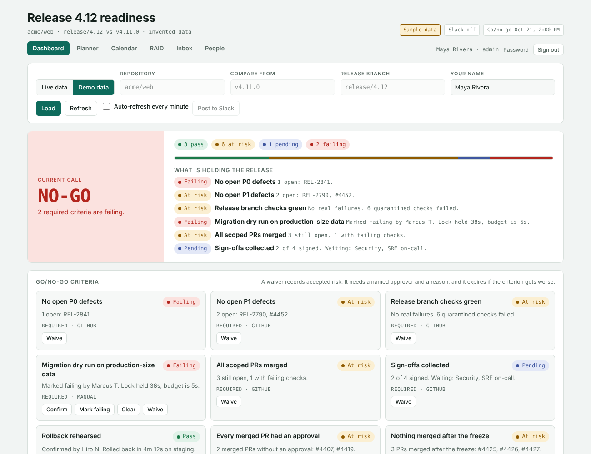

**Contents**

- **Using it:** [The problem](#the-problem) · [What it does](#what-it-does) · [Dependencies](#dependencies-what-waits-on-what) · [Every release](#using-it-for-every-release) · [Release docs](#release-docs)
- **Automation:** [Auto-refresh and Slack alerts](#auto-refresh-and-slack-alerts) · [AI helpers](#ai-helpers) · [Agent](#agent-check-this-release)
- **Running it:** [Sign-in and roles](#sign-in-roles-and-privacy) · [On your computer](#run-it-on-your-computer) · [For a team](#run-it-for-a-team) · [Online](#putting-it-online) · [Connect your tools](#connect-your-tools)
- **Reference:** [How it works](#how-it-works) · [Risk model](#the-risk-model) · [Layout](#layout) · [Limits](#limits-to-know-about) · [Calendar](#release-calendar) · [RAID](#raid-log) · [Where it goes next](#where-it-goes-next) · [Demo script](#demo-script-three-minutes)

## The problem

Before a release, someone collects status by hand from the issue tracker, CI, the security scanner and a dozen Slack threads, then argues about whether it is safe to ship. The answer is in a spreadsheet nobody trusts and a meeting nobody enjoys. This tool puts that answer in one place, computed from the same rules every time, with the reasons attached.

## What it does

**Dashboard (`/`)** reads a real release from GitHub (and Jira, if configured) and shows a Go, Hold or No-Go call with the criteria behind it.

**Planner (`/plan.html`)** is for entering a release by hand, or pulling its Jira tickets and story points. It produces:

- the same go/no-go call, using the same engine
- a risk score out of 100 with a breakdown by factor, plain-language recommendations, and a suggested staged rollout
- a story-point forecast: points done, points remaining, and whether the team's velocity can finish before the freeze
- a runbook, prefilled from the dates, owners and rollout strategy, with one click to add a step for each open handoff
- release history: record how each release went, and see how past calls held up against what happened
- a dependency view: what is waiting on what, what to finish first, and which handoffs between teams are late
- an **agent**: press Check this release and it tells you what changed since the last check, then drafts a Slack update, chase notes for late handoffs and suggestions, all waiting in an Inbox for your OK
- a release brief in Markdown (who, what, when, where, how, dependencies, risk, criteria, runbook) to paste into Slack or Confluence

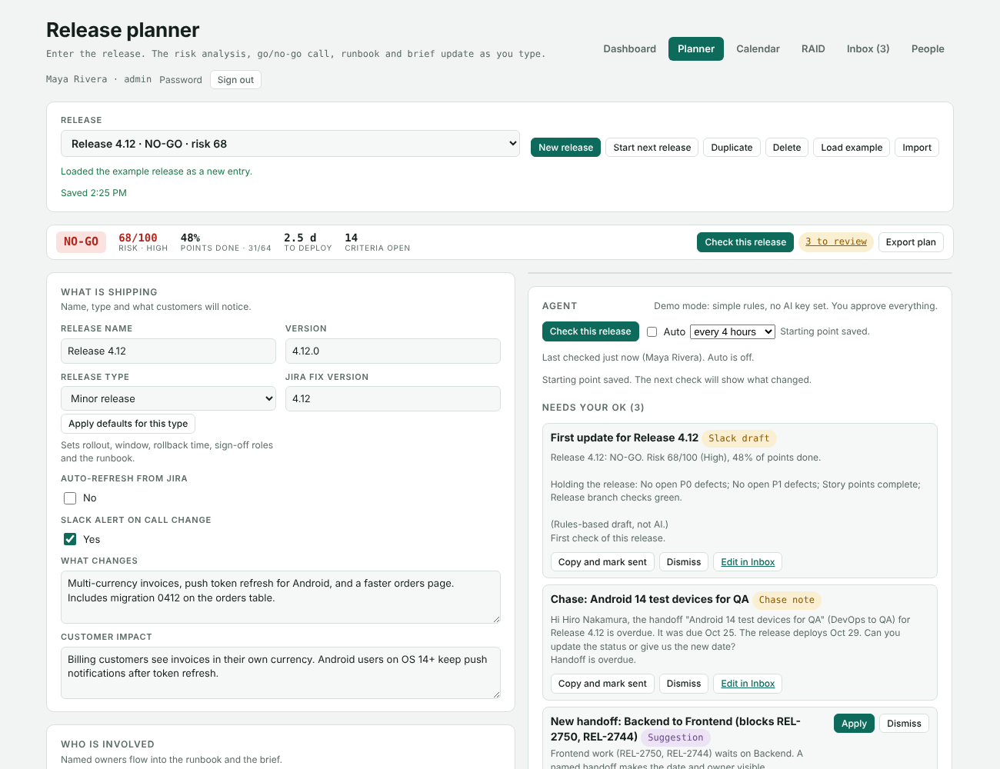

It works on a phone too:

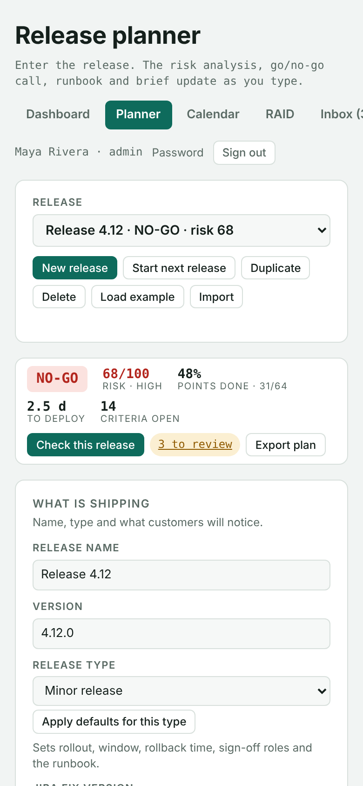

<details>
<summary>More screens</summary>

The risk analysis, with a score out of 100 and the reason behind each factor:

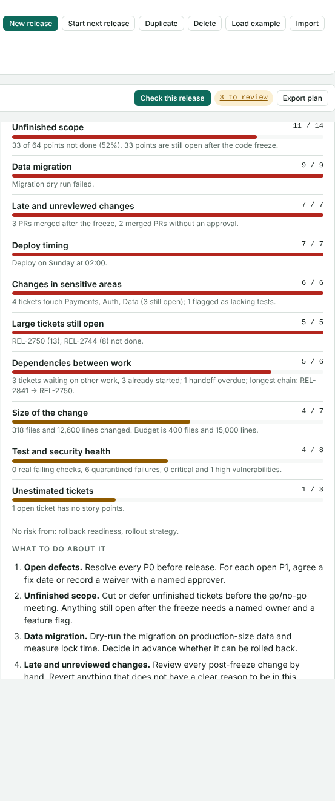

The ticket table, with team, blocked-by and migration columns:

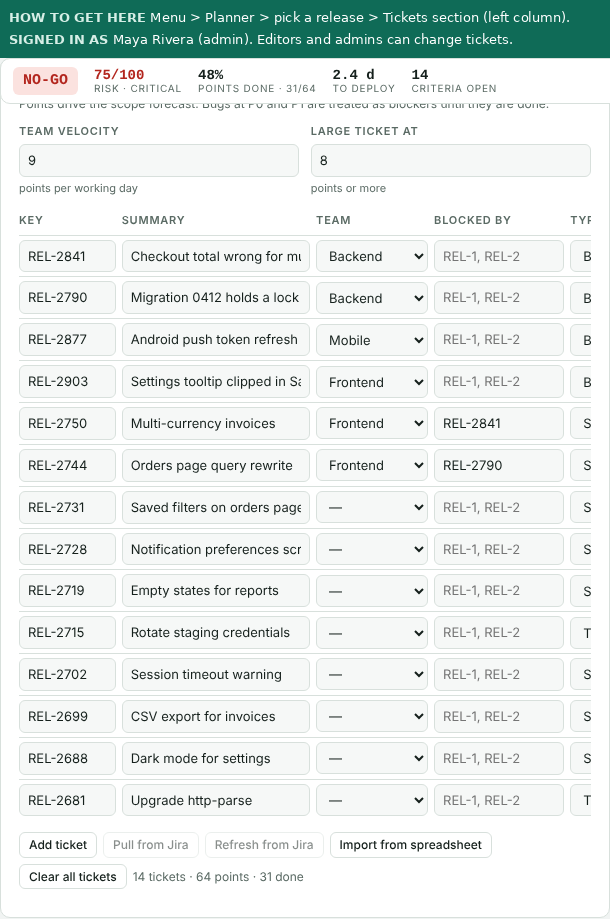

The full printable release report (Word and PDF versions look the same):

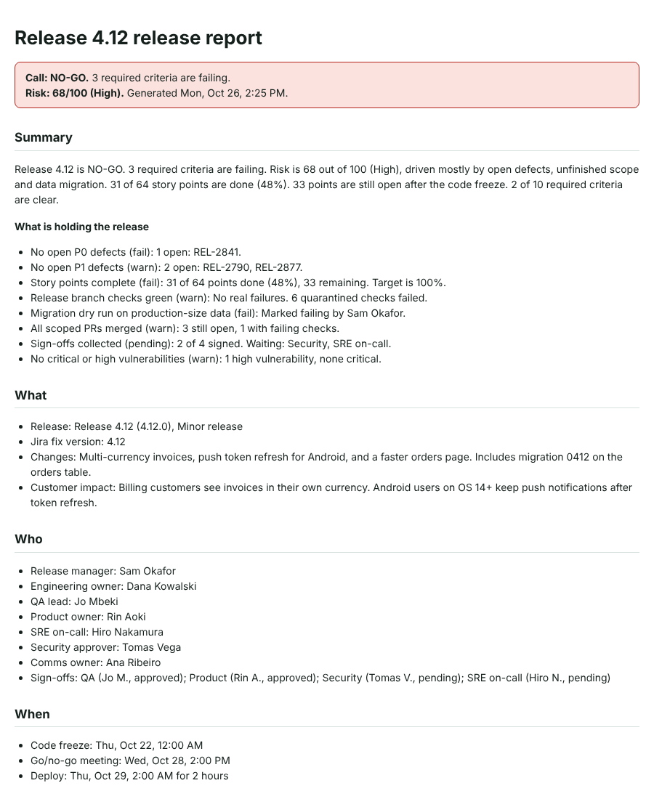

</details>

## Dependencies: what waits on what

Some work cannot start until other work is done: the frontend waits for the backend, QA waits for the merge, tickets cannot be written until the designs are handed over. Two things in the planner capture this.

- **Team and Blocked by** on each ticket. Name the team doing the work, and list the tickets that must be Done first, separated by commas (for example `REL-2841, REL-2790`).
- **Handoffs between teams**, a table below the tickets. Each row is something one team hands to another (a name, who from, who to, an owner, a due date, a status) and the tickets it blocks. Ticket keys in these lists are not case sensitive.

From that the planner shows, in a Dependencies panel and in the release brief:

- tickets that are **waiting**, and on what
- the **longest chain** that has to happen in order
- the tickets to **finish first**, ranked by how many others they hold up
- work **started before its input was done** (in progress or in review while the blocker is open)
- tickets that are **ready to start now**
- **handoffs to chase**: overdue, blocked, or due after the code freeze
- **circular dependencies**, where tickets wait on each other so none can start

It adds a **Dependencies clear** check to go/no-go (advisory by default; a release can make it required) and a Dependencies factor to the risk score. A blocker that is not in this release's ticket list counts as unresolved, and the Blocked by box is highlighted. **Pull from Jira** fills Blocked by from Jira "is blocked by" links, and **Refresh from Jira** keeps what you typed. I tested the Jira links against a mock, not a live Jira.

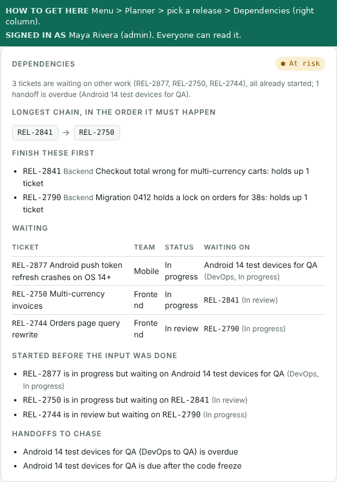

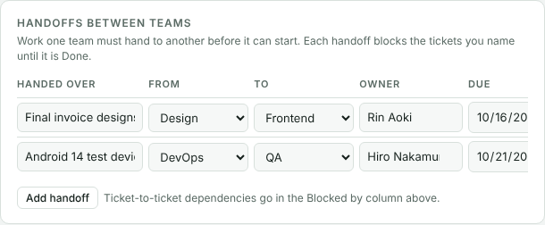

## Using it for every release

The planner keeps a library of releases, so each new release starts clean and the old ones stay available.

| Button | What it does |
|---|---|
| **New release** | An empty release with sensible defaults: a Tuesday 2 AM deploy at least a week out, freeze and go/no-go dates before it, the sign-offs for the release type, and a runbook. Everything unknown shows as pending, so a new release can never read GO by accident. |
| **Start next release** | The usual way to begin the next release in a series. Keeps the people, repository, environments, rollout and rollback settings, budgets and which sign-offs are needed. Clears the name, dates, tickets, quality signals, checks, approvals and waivers. |
| **Duplicate** | An exact copy, for trying a what-if. |
| **Delete** | Removes the release, with an Undo. |
| **Load example** | Adds the invented example release, for demos. |
| **Import** | Adds a release from a plan file saved with Export plan. |

Pick a release from the list at the top to switch. Each release shows its current call and risk score in the list.

Releases are saved on the server, so everyone signed in sees the same list. The page checks for changes by other people every 20 seconds and never replaces what you are typing. **Export plan** and **Import** still work for backups and for moving a release between servers. The single-file copy saves in the browser only.

Per-release criteria are already supported by the engine: a release can switch a criterion off, make it advisory, or add its own checks that a person confirms. There is no screen for it yet, so today that is set in the plan file.

## Runbook steps from handoffs

Under **Runbook**, press **Add steps from handoffs**. Each handoff that is not Done gets a Pre-release step: "Handoff: Android 14 test devices (DevOps to QA)", with the handoff's owner and due date. Steps sit with the other pre-release steps, earliest due first.

- Press it again later and the steps it made follow their handoff: In progress becomes doing, Blocked becomes blocked, Done becomes done. Nothing is removed, and steps you wrote yourself are never touched.
- A handoff that is already Done gets no step. A handoff with no owner falls back to the release manager.
- A step that is past its time and not done counts toward the "Pre-release steps on schedule" check, like any other pre-release step.
- **Regenerate from plan** still replaces every step, so press **Add steps from handoffs** again after it.
- Steps are matched by the handoff's text, From and To. If you rename a handoff, the old step stays and a new one is added; delete the old one by hand.

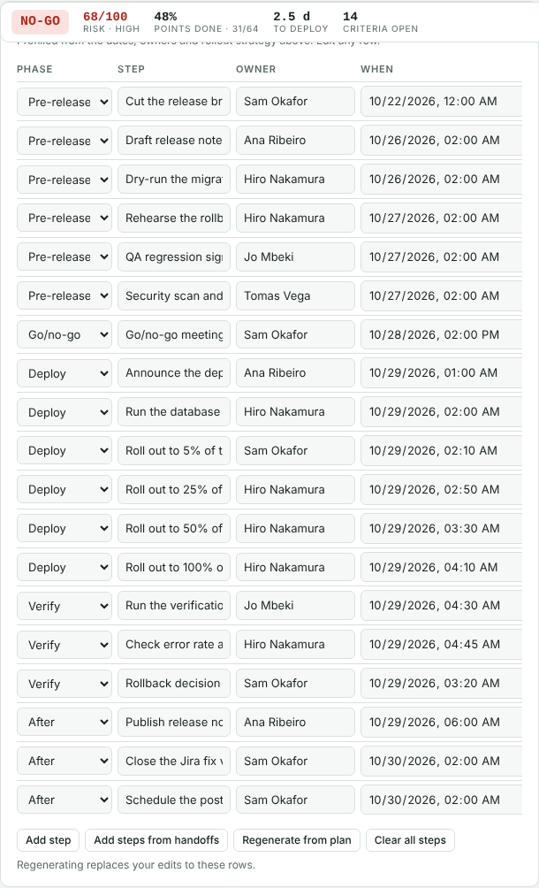

## Release history

When a release is done, open the last section on the left, **After the release**, and pick how it went: shipped cleanly, shipped with issues, rolled back, or cancelled. Add a note about what happened and what to change next time.

- Picking an outcome **closes** the release. The tool saves the call and risk score as they were at that moment, and fills in the closing time if it is empty.
- A closed release stops auto-refreshing from Jira, stops sending Slack alerts, and is skipped by Auto checks. Clear the outcome to reopen it.
- The **Release history** panel at the bottom of the results lists every closed release, newest first, with a counts line and how each call held up: for example "NO-GO at close: 1 shipped, 1 had issues or were rolled back". The line "N shipped while the call was HOLD or NO-GO" is the one to look at.
- **Duplicate** and **Start next release** always begin open.

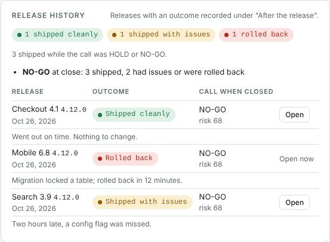

## Release calendar

Open **Calendar** in the top menu. Every open release sits on one timeline: a bar for the deploy window, a thin line for the freeze, a dot for the go/no-go meeting, and a red line for now. Pick 2, 4 or 8 weeks. Closed releases are hidden unless you tick the box.

The tool checks every pair of open releases for five kinds of clash:

| Clash | Level | Plain meaning |
| --- | --- | --- |
| Overlap | Clash | Two deploy windows run at the same time |
| Too close | Close | Two deploys are less than 12 hours apart |
| Shared people | Close | The same release manager, SRE or QA lead is on two deploys less than 24 hours apart |
| Freeze clash | Close | A deploy lands inside another release's freeze, on the same repository |
| Meeting clash | Heads up | Two go/no-go meetings within an hour, with the same release manager |

Each clash lists free slots (same time of day, weekdays only, nothing else clashing) for moving either release. The open release also shows a banner in the planner when it clashes with another one. The agent writes a **Schedule clash** chase note into the Inbox for medium and high clashes.

**AI here is optional and narrow.** The button **Ask AI which to move** (editors only) sends only the clashes, the call of each release, and the free slots. It never changes a date. Advice is checked: it must name a real clash, a real release and a slot that was offered, or it is dropped. With no clashes there is no AI call. Without an API key the same button uses a plain rule (move the release that deploys later).

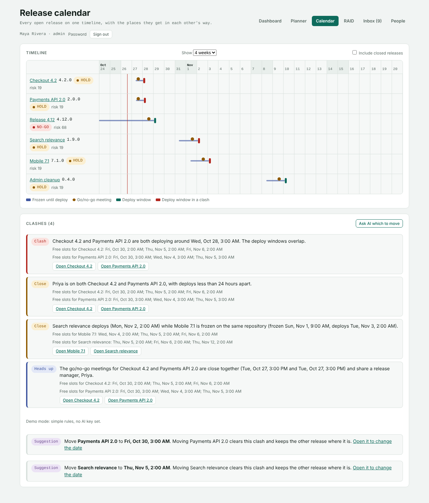

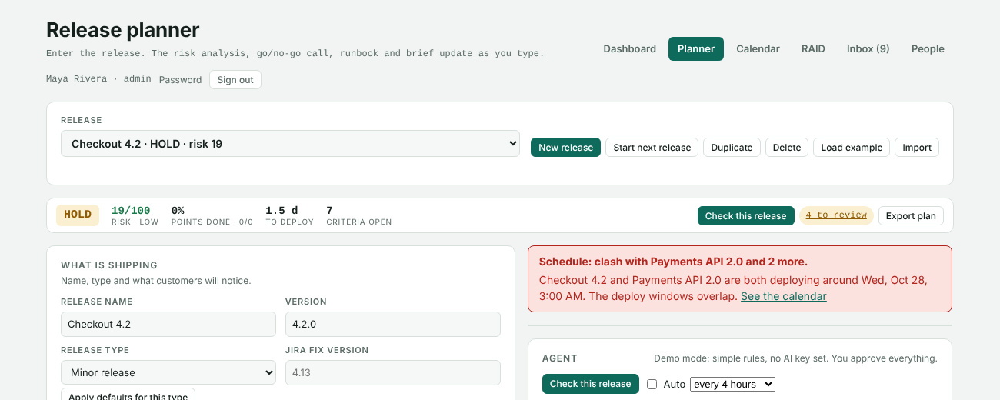

**Change the rules.** The numbers (12 hours, 24 hours, which roles count as people) are in `DEFAULT_RULES` in `src/schedule.js`. To add a new kind of clash, add one entry to `CHECKS` in the same file: `{ id, severity, test(a, b, rules) }`. The calendar, banner, AI check and agent all read the result, so nothing else changes.

## RAID log

RAID stands for Risks, Assumptions, Issues and Dependencies. Every release has its own log, under **RAID log** on the left of the planner. Each item has a type, what it is, an owner, a due date, a rating (High, Medium, Low), a status and what you are doing about it. The status choices fit the type: a risk or issue is Open, Mitigating (or In progress) or Closed; an assumption is Unchecked, Confirmed or Wrong.

The **RAID log** panel on the right shows what is open and risky right now, and **suggests** items the tool can see for itself:

| Suggested type | Where it comes from |
| --- | --- |
| Issue | An open P0 or P1 bug, or a failed migration or rollback check |
| Dependency | An overdue handoff, or a ticket waiting on other work |
| Risk | A high-scoring factor in the risk analysis, or a medium or high schedule clash from the calendar |

Add puts a suggestion in the log, Dismiss hides it for good, and Add all takes the lot. Nothing is added without a click. The list shows the most serious eight at a time.

- **AI, only where it fits.** The button **Ask AI for more** reads the tickets and handoffs and suggests risks and assumptions you have not listed. The rules already cover issues and dependencies, so the AI does not. Its answers are checked (valid type, real text, no repeats, at most 8) and it only suggests. In demo mode there is no AI and the button says so.
- **Agent.** An open item with an owner that is past its due date becomes a chase note in the Inbox, once per due date. Items with no owner are shown in the panel instead.
- **Across releases.** The **RAID** page lists every open item from every release, overdue first, then by rating. Filter by type, rating, owner or release, and tick the box to include closed items and releases.
- **Next release.** Start next release keeps the open risks and assumptions and drops issues and dependencies, which belong to the release they were found in.

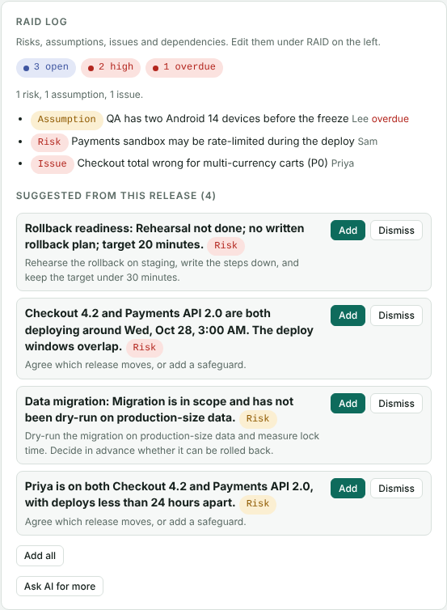

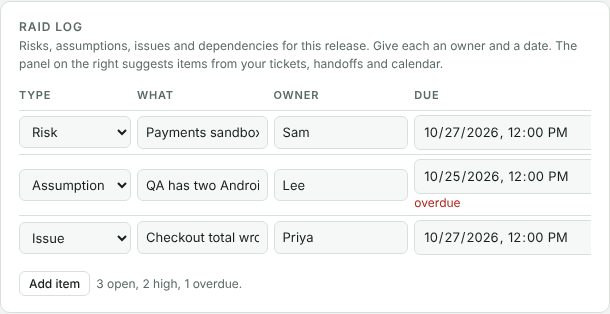

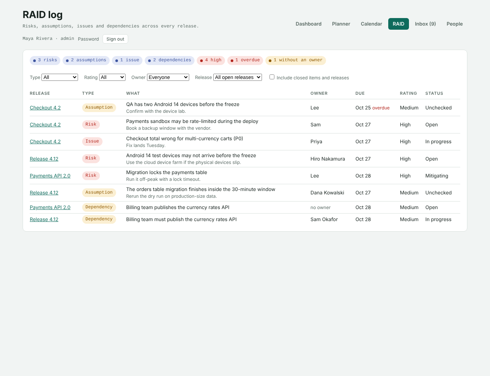

**Change it.** The lists (types, statuses, ratings) are constants at the top of `src/raid.js`. To suggest a new kind of item, add one entry to `SOURCES` in the same file: `{ id, build(plan, ctx) }` returning suggestions with a stable `source` string. The planner panel, the page and the AI all read the result.

## Release docs

In the planner, the **Release brief** panel has:

- **Copy for Docs**: paste into Google Docs, Word, Confluence or Notion with headings and tables kept.
- **Word (.doc)**: opens in Word.
- **Printable page**: open it, press Print, choose Save as PDF.
- **Status one-pager**: just the call, dates and risks, for leadership.
- **.md** and **Copy Markdown**: plain text.

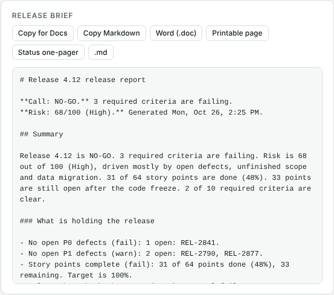

The one-page status for leadership:

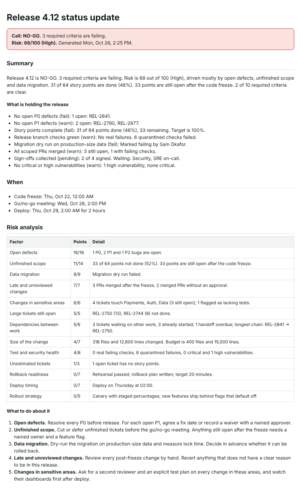

## Auto-refresh and Slack alerts

Open a release, find **What is shipping**, and tick:

- **Refresh from Jira every few minutes**: the server pulls the fix version on its own (every `SYNC_MINUTES`, default 5), even when nobody has the page open. Needs the Jira settings and a fix version.
- **Post to Slack when the go/no-go call changes**: the server checks each release every minute. When the call changes (say GO to HOLD) and stays changed for `ALERT_SETTLE_MINUTES` (default 2), it posts one message naming both calls and what is holding. Needs `SLACK_WEBHOOK_URL`. The first look at a release never alerts, and a call that flips back before the wait ends sends nothing.

The planner shows when the last refresh happened and any error. The dashboard has an **Auto-refresh every minute** box that only re-reads while the page is open.

The jobs run only while the server is running. On your laptop that means while it is on. For always-on alerts, host it (see above).

## AI helpers

Three buttons, under **Quick helpers** in the planner's Agent panel (they answer on screen and save nothing; the Agent below does the same work and keeps the results in an Inbox):

- **Write status update**: a short update in plain words, for leadership or for the team.
- **Spot risks**: finds tickets that mention a database change or payments, sign-in or personal data but are not marked that way.
- **Find dependencies**: finds work that probably waits on other work (frontend on backend, QA on the merge), suggests teams, and suggests handoffs.

How it behaves:

- **It only suggests.** Every suggestion has a reason and a confidence, and nothing changes until you press **Apply**. The GO / HOLD / NO-GO call always comes from the rules, never from the AI.
- **Demo mode (default).** With no key it uses simple rules. It costs nothing and sends nothing anywhere. Drafts are labelled "Rules-based draft".
- **Live mode.** Set `ANTHROPIC_API_KEY` and it asks Claude. Drafts are labelled "AI draft: check before sending".
- **What Claude sees.** For the status update: the release name, summary, dates, the call and why, the top risks, counts, the release manager's name, and which tickets wait on what. For the two finders: ticket keys, titles, type, priority, status, area, team and blocked-by. It does not see emails, passwords, Jira tokens or the people list. Ticket titles do leave your server in live mode, so check that is allowed where you work.
- **Safety.** Ticket text is treated as data, not instructions. Suggestions are checked before you see them: made-up tickets, unknown teams and repeats are dropped. Editors and admins only. Each person is limited to 30 requests an hour (`AI_PER_HOUR`).
- **Not yet tried against the real API.** Live mode is tested with a stand-in service. Try it with a real key and a small test release first.

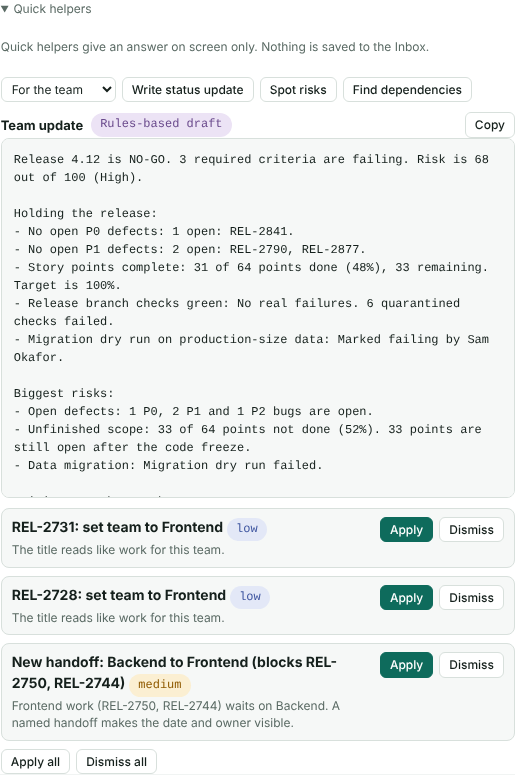

The same panel, writing for leadership:

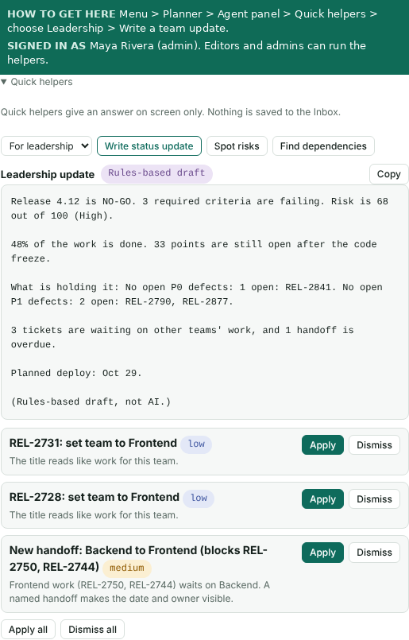

How the helpers stay safe:

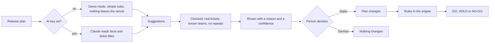

The go/no-go call comes only from the rules on the right. The AI can change what the rules see only when a person presses Apply.

## Agent: check this release

The agent watches a release for you and prepares what you would probably do next. A person stays in charge: it only drafts, and you approve everything.

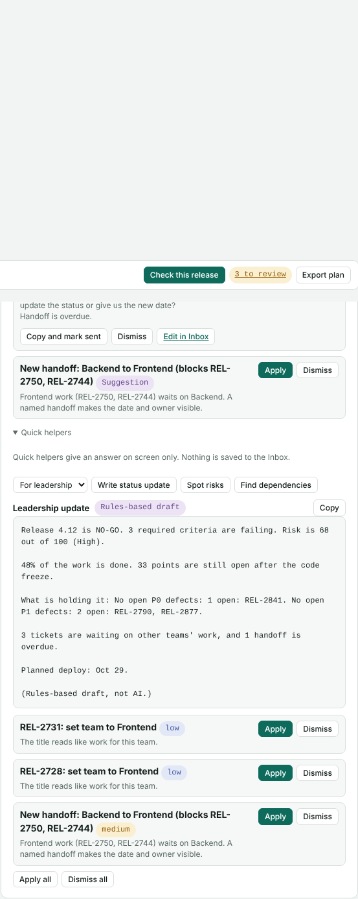

**How to use it**

1. Open a release in the planner. The **Check this release** button is in the bar at the top, and the full **Agent** panel is at the top of the right column.
2. Press it. The first time, it saves a starting point and drafts a first update.
3. Change things (move a ticket, change a date) and press it again. It shows **what changed since the check before**, most important first.
4. Under **Needs your OK**, each draft has buttons:
   - **Slack draft**: Post to Slack, or Copy and mark sent. Edit the text in the Inbox first if you like.
   - **Chase note**: text for a person who owns a late or blocked handoff. Copy it and send it yourself.
   - **Suggestion**: Apply puts the change in the plan. Dismiss throws it away and it will not come back.
5. The **Inbox** page lists everything across all releases, with the count shown next to the link.

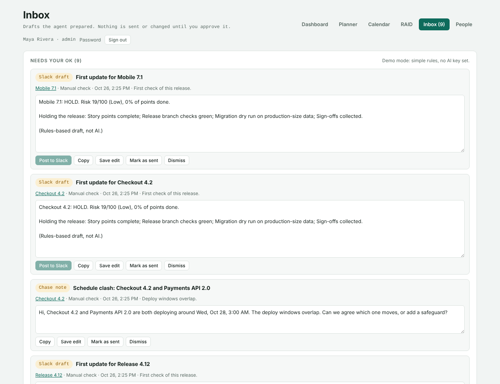

**Auto (optional)**

Tick **Auto** in the panel and pick how often (every hour, 4 hours, 12 hours or daily). The server then runs the same check by itself. It is off by default. Auto only prepares drafts. It never posts to Slack, never changes the plan and never contacts anyone. It stays quiet when nothing changed, and it is capped at `AGENT_PER_DAY` runs per release per day (default 12). It only runs while the server is running.

**Rules it follows**

- The GO / HOLD / NO-GO call always comes from the rules, never from the agent.
- Nothing leaves the tool and nothing in the plan changes until a person presses a button.
- Drafts are not repeated. A suggestion you dismissed stays dismissed, and one that no longer applies is removed. A newer Slack update replaces an older one nobody sent.
- Every decision is recorded with who made it and when, and shown under Recently handled.
- Viewers can read the Inbox but cannot check, switch Auto or decide.
- Demo mode (no AI key) uses plain rules and costs nothing. With `ANTHROPIC_API_KEY`, Claude writes the Slack update. Chase notes and suggestions always follow the rules and checks described under AI helpers.

**What it saves**: `agent.json` in the data folder (last check for each release, the Auto settings, and the Inbox). Back it up with the rest of that folder.

## Sign-in, roles and privacy

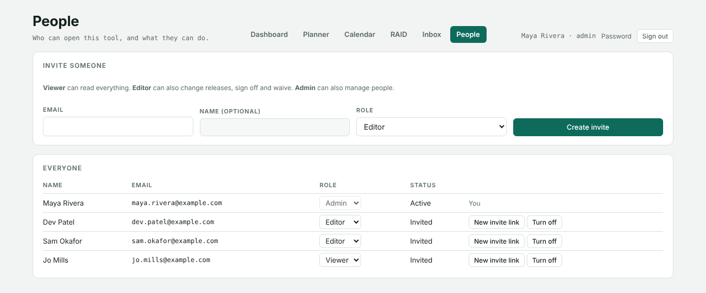

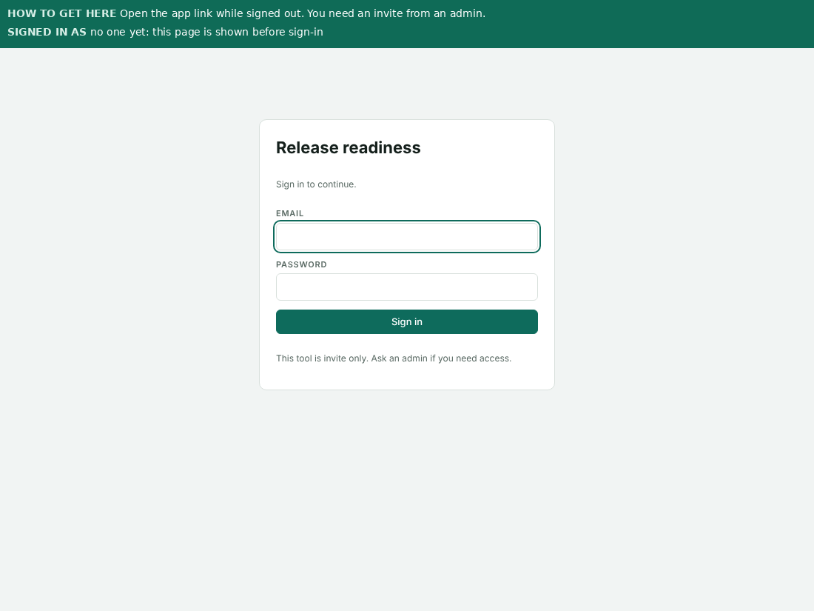

**Invite only.** There is no sign-up page. An admin adds an email and a role, and the person gets a one-time link to choose their own password. The link works once and expires in 7 days.

| Role | Can do |
|---|---|
| **Viewer** | Read the dashboard, planner and releases. Cannot change anything. |
| **Editor** | Everything a viewer can, plus create and edit releases, sign off, waive, mark checks, post to Slack, pull from Jira. |
| **Admin** | Everything an editor can, plus invite people, change roles, turn people off. |

What is in place:

- Passwords are stored as scrypt hashes. The server never keeps a password it could read back.
- Sessions are signed cookies (HttpOnly, SameSite=Strict, Secure over https) that last 12 hours. Changing a password, or turning a person off, ends their sessions at once.
- Five wrong passwords for one email from one address lock that pair for 15 minutes. The same wrong-password message is given for unknown emails.
- Every page and every API call needs a session, except the sign-in and invite pages. The role is checked on the server for each call, so hiding a button is never the only protection.
- The name on a waiver, a manual check or a Slack post is the signed-in person. It cannot be typed in.
- Two people cannot overwrite each other. Saving a release names the version you started from. If someone saved first, your save is refused and you can load their version or keep yours as a copy.
- There is always at least one active admin.
- Jira and GitHub tokens stay on the server.

Not included yet: single sign-on (Okta, Google, Microsoft), password reset by email (an admin sends a new invite link instead), two-factor sign-in, and a log of every edit to a release (the audit log records creates, deletes, waivers and checks). See "Limits".

## Run it on your computer

Needs Node 20 or newer. No dependencies to install.

```bash
git clone https://github.com/moeramen112/releasedoclogin.git
cd releasedoclogin
npm run try          # demo data, no sign-in, this computer only
```

Open http://localhost:3000. `npm run try` turns sign-in off and refuses to do so on any address except your own computer. It is for looking around.

To run it with sign-in, as your team would:

```bash
# Mac or Linux
ADMIN_EMAIL=you@yourcompany.com npm start
# Windows PowerShell
$env:ADMIN_EMAIL="you@yourcompany.com"; npm start
```

The first start prints a link in the terminal. Open it, choose your password, and you are the admin. Then open **People** to invite everyone else. Add `--demo` to use invented dashboard data.

## Run it for a team

1. Run it on a computer that stays on and that your team can reach: a company server, or a small hosting account your IT approves. Do not put real company data on a personal hosting account without asking IT.
2. Put it behind https. Most hosts do this for you. Set `COOKIE_SECURE=1`, and `TRUST_PROXY=1` if a proxy in front of the server adds `x-forwarded-proto`.
3. Set these before starting:

| Variable | Why |
|---|---|
| `ADMIN_EMAIL` | Creates the first admin on first start. |
| `PUBLIC_URL` | The address people use, so invite links are right. |
| `HOST=0.0.0.0` | Listen on the network. The default is this computer only. |
| `STATE_DIR` | A folder that survives restarts (a persistent disk). Users, releases and audit logs live here. |
| `COOKIE_SECURE=1`, `TRUST_PROXY=1` | For https behind a proxy. |

4. Back up the `STATE_DIR` folder. It holds everything, including the password hashes, so keep it private.
5. Many hosts erase files on every restart unless you attach a persistent disk. Check this first, or people will lose their accounts and releases.

I have run it locally and tested the sign-in, roles and saving with browser tests. I have not deployed it to a hosting service.

The single-file copy (`dist/release-planner.standalone.html`) is separate: it has no sign-in and saves in the browser only.

## Putting it online

See `HOSTING.md` for step-by-step setup on Render (a `Dockerfile` and `render.yaml` are included, so Railway and Fly.io work too). If you miss the first admin link, set `RESEND_ADMIN_LINK=1` and restart to get a new one.

## Connect your tools

Copy `.env.example` and set what you have. Everything is optional.

| Variable | What it enables |
|---|---|
| `GITHUB_TOKEN` | Higher rate limit and private repositories. Public repositories work without it. |
| `JIRA_BASE_URL`, `JIRA_EMAIL`, `JIRA_API_TOKEN` | Open P0/P1 issues on the dashboard, and **Pull from Jira** in the planner (tickets plus story points). |
| `SLACK_WEBHOOK_URL` | **Post to Slack** sends the current call and what is holding the release. |

Edit `readiness.config.json` to change the repository, release branch, label names, JQL, the Jira story-points field (`customfield_10016` on most sites, but it varies), and the list of criteria.

## How it works


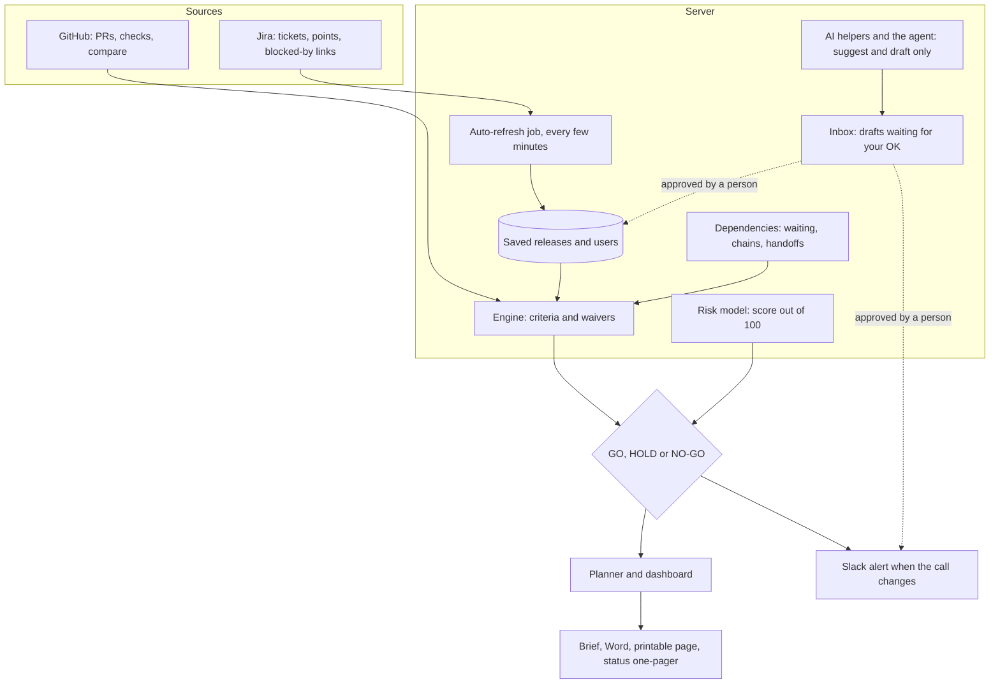

```
GitHub ─┐
Jira ───┼─► snapshot ─► engine ─► verdict + criteria ─► dashboard
Form ───┘   (one shape)  (pure)                         planner, brief, Slack
                          ▲
              waivers and manual checks (the audit log)
```

- **One engine.** Every source is normalised to one snapshot shape, and a pure function turns a snapshot plus the config into criteria and a verdict. The server and the browser run the same file, so the dashboard and the planner cannot disagree.
- **Missing data never passes.** If GitHub rate-limits a call or Jira is down, the affected criterion shows as pending with the reason, and the release cannot read GO.
- **Waivers are accountable.** Accepting a risk needs a named approver and a reason. A waiver stops applying if the criterion gets worse afterwards, and every change goes to an audit log.
- **Criteria are config.** Which checks count, whether they are required, and how strict they are all live in the config, not in code.
- **Tokens stay on the server.** The browser never sees them. Changes require a custom header and a same-origin request, so another web page cannot post to a dashboard running on localhost.

## The risk model

Thirteen factors, weighted to add up to 100. The weights are in `src/risk.js` and each has a test.

| Factor | Max | What drives it |
|---|---|---|
| Open defects | 16 | P0 bugs 10 each, P1 4, P2 1 |
| Unfinished scope | 14 | Share of story points not done, plus a penalty if velocity cannot finish before the freeze or work is open after it |
| Data migration | 9 | In scope and not dry-run on production-size data |
| Rollback readiness | 7 | Not rehearsed, no written plan, or a target over 30 minutes |
| Dependencies between work | 6 | Tickets waiting on other work, work started before its input was done, overdue or blocked handoffs, long chains, circular dependencies |
| Test and security health | 8 | Real failing checks, quarantined failures, coverage, p95 latency, vulnerabilities |
| Size of the change | 7 | Files and lines against a budget |
| Late and unreviewed changes | 7 | Merged after the freeze, merged without an approval |
| Deploy timing | 7 | Friday, weekend, business hours, long windows |
| Payments, auth and data changes | 6 | Open tickets in sensitive areas count most, missing tests count extra |
| Large tickets still open | 5 | Tickets over a point threshold that are not done |
| Rollout strategy | 5 | All-at-once is worst, canary with flags that default off is best |
| Unestimated tickets | 3 | Open work with no story points |

Levels: under 25 Low, under 50 Moderate, under 75 High, otherwise Critical. Each level suggests a rollout ladder: for example Low is 10%, 50%, 100% with a 15 minute bake, and High starts at 1% with an hour at each stage.

## Layout

```
src/engine.js      criteria evaluators, waivers, verdict (pure)
src/risk.js        story points, forecast, risk score (pure)
src/deps.js        what waits on what: blockers, handoffs, cycles, chains (pure)
src/plan.js        the plan, templates, runbook generator and handoff steps, brief (pure)
src/history.js     release history: the call when closed, rows and summary (pure)
src/schedule.js    release calendar: clash checks, rules, free slots (pure)
src/raid.js        RAID log: items, rule-based suggestions, cross-release view (pure)
src/raid-view.js   the RAID page table and counts as HTML (pure)
src/schedule-view.js  calendar timeline, clash cards and planner banner as HTML (pure)
src/html.js        the one escape helper shared by the pure view modules
src/sources/       GitHub, Jira, and demo-data adapters
src/server.js      HTTP server and JSON API
src/auth.js        accounts, sessions, invites, roles (no dependencies)
src/ai.js          AI helpers: status update, risk spotter, dependency finder, schedule check (demo rules or Claude)
src/agent.js       the agent: what changed since the last check, and the drafts (pure)
src/agent-service.js  runs the agent, keeps the Inbox, applies your decisions
src/jobs.js        the timer: Jira auto-refresh, Slack alerts, Auto checks
public/            dashboard, planner, calendar, RAID, inbox, sign-in, people (plain JS, no build step)
public/plan-ui.js  the planner page; panels.js, assist.js and uikit.js hold the result panels, the AI and agent panel, and shared helpers
test/              187 tests, including a mock GitHub, a mock Jira, a mock Slack and a mock AI service
scripts/           build-standalone.mjs makes the single-file planner
```

## Limits to know about

- State is JSON files in the data folder. Writes are queued and atomic, which is fine for a team of tens. It is not built for hundreds of people editing at once.
- Sign-in is email and password only. No single sign-on, no two-factor, no password reset by email. A forgotten password means an admin sends a new invite link.
- The server speaks plain HTTP. For anything beyond your own computer, put it behind https.
- A release plan is saved as a whole, so two people editing the same release at the same time get a conflict message, not a merge.
- Someone with view-only access can still change the page in their own browser. The server refuses to save it.
- The Jira search uses the current `/rest/api/3/search/jql` endpoint and the story-points field name must be set for your site. I tested it against a mock, not a live Jira.
- Scores are a starting point for a conversation. The weights are opinions, and they are easy to change.
- Auto checks and Slack alerts only run while the server is running. On a laptop that means while it is on.
- Live AI mode has only been tested against a stand-in service, not the real Anthropic API. Try it on a small test release first.
- The agent only drafts. It cannot email anyone: a chase note is text you copy. Posting to Slack needs `SLACK_WEBHOOK_URL`.
- The agent reads ticket titles, not Jira descriptions, so its suggestions are only as good as the titles.

## Where it goes next

1. Read CI status from the CI provider directly, and map it to the release branch automatically.
2. Learn the weights from history: which factors preceded a rollback or an incident.
3. Trends over time in Release history (for example risk against outcome, by month).
4. Let the agent read Jira descriptions and comments, and email chase notes with approval.
5. Per-team criteria sets.
6. Release calendar: drag a deploy bar to a new date, and show on-call and holiday calendars.

## Demo script (three minutes)

1. **The problem (20 seconds).** "Release readiness lives in people's heads and in five tools. Someone assembles it by hand before every go/no-go."
2. **The dashboard (60 seconds).** Open `/` in demo mode. Point at the NO-GO and the three reasons under it. "Everything on the right is computed, nothing is typed in." Click Waive on a failing criterion, show that it demands a named approver and a reason, and show the audit log.
3. **The planner (60 seconds).** Open `/plan.html`. Change the P0 ticket to Done and watch the call and risk score move. Change the deploy time to a Friday afternoon and show the timing risk. Clear all tickets, then Undo.
4. **The agent (30 seconds).** Press **Check this release**. Move a ticket back to To do, press it again, and show what changed plus the drafted Slack update. Open the Inbox: nothing is sent until you press Post. "The tool does the watching. A person stays accountable for the call."
5. **The brief (20 seconds).** Copy Markdown and show it is a complete release document.
6. **The design choice (20 seconds).** "If a data source is down, that criterion is pending, not passing. A tool that says GO when it cannot see is worse than no tool."

Questions to expect: why these weights (opinions with tests, meant to be tuned), what about monorepos or many services (one release per config today, and the per-team config is the next step), how it would connect to your systems (adapters return one shape, so a new source is one file).
